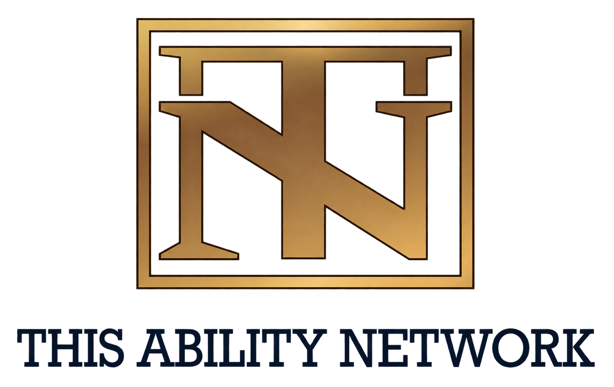

<div align="center">

# This Ability Network

[한국어](README-ko.md) · **[English](README-en.md)**



The bilingual website for This Ability Network and This Ability Orchestra.

</div>

## Hextra Migration Preview

Install Hugo and Go, then start the development server from the repository root.

```sh
hugo server --bind 127.0.0.1 --port 8774
```

Open the [English](http://127.0.0.1:8774/en/) or [Korean](http://127.0.0.1:8774/ko/) site.

## Editing Content

Edit the English and Korean content in `content/_index.en.md` and `content/_index.ko.md`, respectively. Menu translations are in `i18n/`, and theme settings are in `hugo.toml`. Update both languages when changing copy or image alt text.

Original images and web-ready variants are stored in `assets/image/`. The existing `/assets/image/` URLs continue to work after a Hugo build.

## Hosting

Run `hugo --panicOnWarning` to build the English and Korean pages into `public/`. When changes reach `main`, GitHub Actions runs the same command and deploys the output to GitHub Pages.

## Changelog and Versioning

Use Changesets to record changes in Korean. The first planned release is `v0.1.0`.

1. Run `npm ci` to install the versioning tools.
2. For each change, run `npm run changeset` and select the appropriate `patch`, `minor`, or `major` bump.
3. Run `npm run changeset:status` to check the planned version.
4. At release time, run `npm run release:version` to update the version, lockfile, and `CHANGELOG.md`. Review the generated changes, then create the release commit and version tag.
