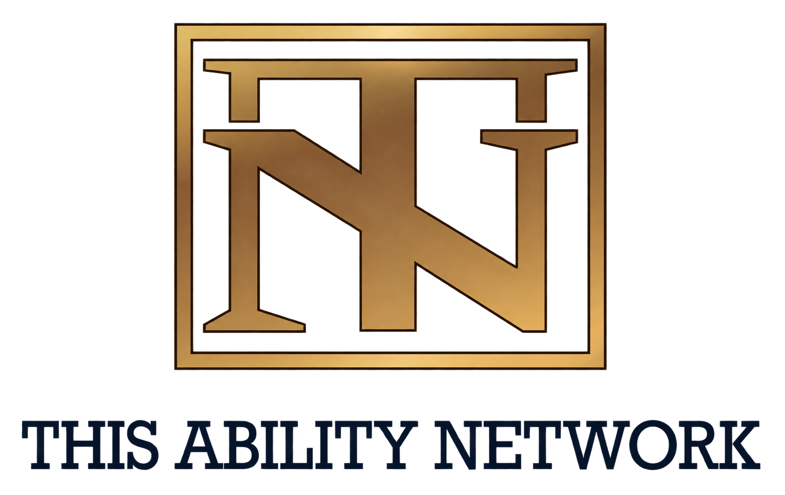

<div align="center">

# This Ability Network



[](.github/workflows/pages.yaml)
[](go.mod)
[](go.mod)
[](.github/workflows/pages.yaml)

**[한국어](README-ko.md)** · [English](README-en.md)

로스앤젤레스 비영리단체 This Ability Network와 주요 프로그램인 This Ability Orchestra를 소개하는 한·영 브랜드 페이지입니다. 오케스트라의 공연 기록과 예정 행사, 참여 방법을 안내합니다.

</div>

## 로컬 실행

배포 환경과 같은 Hugo 0.170.1과 Go 1.27.3을 준비한 뒤 저장소 루트에서 실행합니다.

```sh
hugo server --bind 127.0.0.1 --port 8774
```

[영어](http://127.0.0.1:8774/en/)와 [한국어](http://127.0.0.1:8774/ko/) 페이지에서 확인할 수 있습니다.

## 콘텐츠 편집

영어와 한국어 홈은 각각 `content/_index.en.md`와 `content/_index.ko.md`에서 관리합니다. 행사 목록과 상세 페이지는 `content/events/`에, 메뉴 번역은 `i18n/`에, 사이트 설정은 `hugo.toml`에 있습니다. 문구와 이미지 대체 텍스트를 변경할 때는 두 언어를 함께 수정합니다.

이미지 원본과 웹용 파생 이미지는 `assets/image/`에 보관합니다. Hugo 빌드 후에도 기존 `/assets/image/` 주소에서 이미지를 열 수 있습니다.

## 호스팅

`hugo --panicOnWarning`으로 영어와 한국어 페이지를 `public/`에 빌드합니다. 변경이 `main`에 반영되면 GitHub Actions에서 같은 명령으로 빌드해 GitHub Pages에 배포합니다.

## 변경 기록과 버전

Changesets를 사용해 변경 내용을 한글로 기록합니다. 버전별 변경 사항은 [변경 기록](CHANGELOG.md)에서 확인할 수 있습니다.

1. `npm ci`로 버전 관리에 필요한 개발 도구를 설치합니다.
2. 변경이 있을 때 `npm run changeset`을 실행하고 변경에 맞는 `patch`, `minor`, `major`를 선택합니다.
3. `npm run changeset:status`로 예정된 버전을 확인합니다.
4. 릴리스할 때만 `npm run release:version`을 실행해 버전, 잠금 파일, `CHANGELOG.md`를 갱신합니다. 생성된 변경을 검토한 뒤 릴리스 커밋과 버전 태그를 만듭니다.
