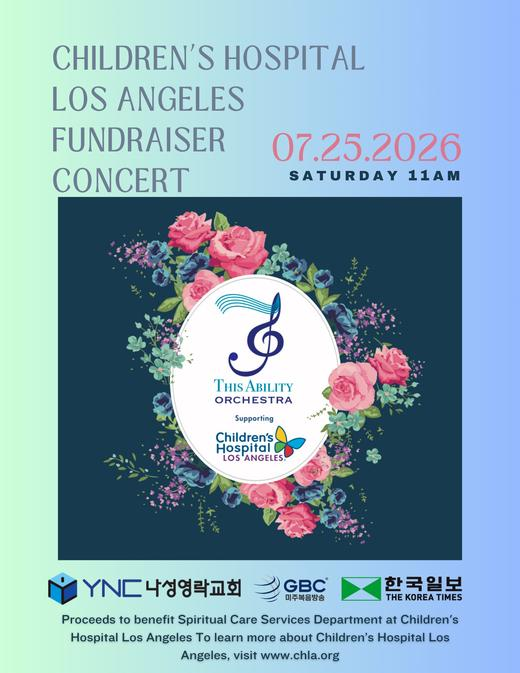
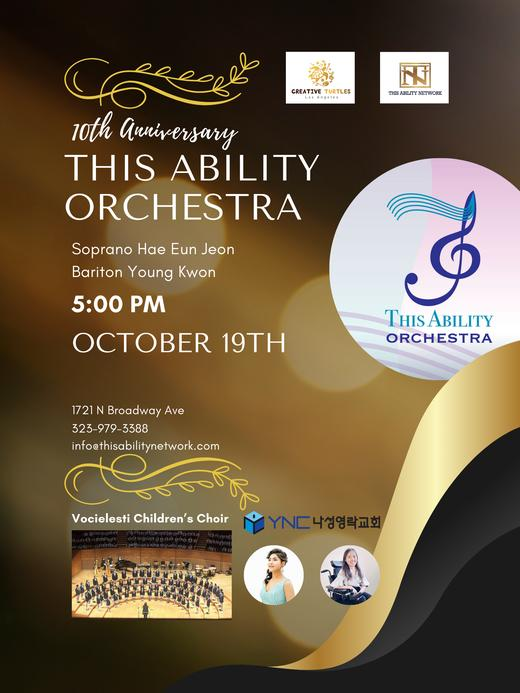
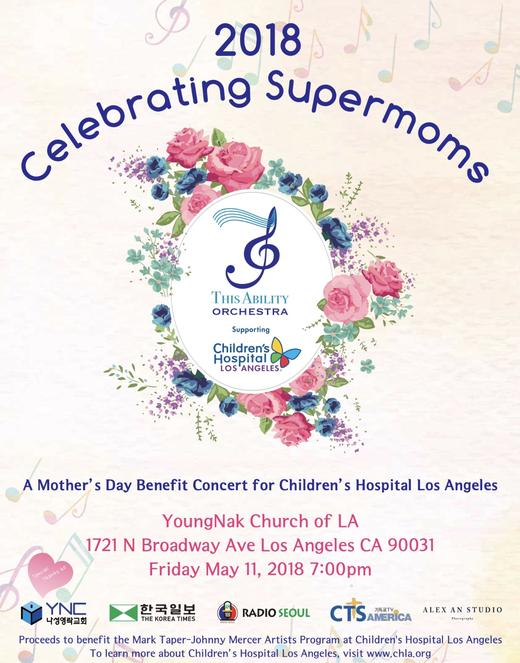
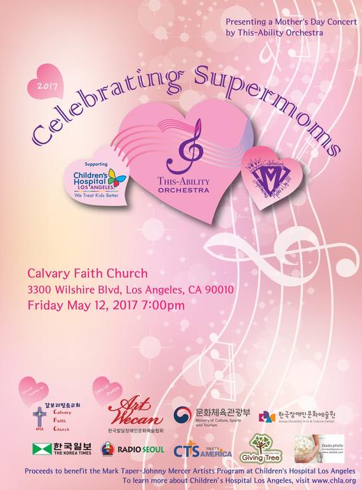



Music makes room for everyone.



This Ability Network is a Los Angeles nonprofit. Through This Ability Orchestra, it brings musicians of all abilities together to play, perform, and give back to the community.









## About Our Network {#network .section-title}

This Ability Network is a 501(c)(3) nonprofit in Los Angeles. We believe that the stage, the rehearsal room, and the community all work better when everyone has a place in them.

Our work centers on This Ability Orchestra, which has been making music since 2014, and on the concerts and events that grow from it.


## Programs {#programs .section-title}



### This Ability Orchestra {#orchestra .section-title}



We bring together musicians of all abilities in an inclusive, collaborative space. Through the universal language of music, each participant can express themselves, connect with others, and have their unique contributions celebrated.

> We enhance connections to the world through music. We deepen understanding of inclusive environments.




#### Making music in Los Angeles since 2014

Our members play strings, winds, piano, and more, side by side. Rehearsals and concerts are built around what each musician can do and brings to the group.




### Concerts that give back {#concerts .section-title}

Each year the Orchestra performs a fundraiser concert for Children’s Hospital Los Angeles, alongside other performances through the year.



- 

  July 25, 2026, 11 a.m.

  #### [2026 CHLA Fundraiser Concert](/en/events/2026-chla-fundraiser/)

  Proceeds supported the Spiritual Care Services Department at Children’s Hospital Los Angeles. Supporters could take home a CHLA eco bag for $20.

- 

  October 19, 2024, 5 p.m.

  #### [2024 10th Anniversary Concert](/en/events/2024-10th-anniversary/)

  A celebration of ten years, with soprano Hae Eun Jeon, baritone Young Kwon, and the Vocielesti Children’s Choir.

- 

  May 11, 2018, 7 p.m.

  #### [2018 Celebrating Supermoms](/en/events/2018-celebrating-supermoms/)

  A Mother’s Day benefit concert for Children’s Hospital Los Angeles at YoungNak Church of LA. Proceeds supported the Mark Taper–Johnny Mercer Artists Program.

- 

  May 12, 2017, 7 p.m.

  #### [2017 Celebrating Supermoms](/en/events/2017-celebrating-supermoms/)

  Presented at Calvary Faith Church in support of Children’s Hospital Los Angeles and its Mark Taper–Johnny Mercer Artists Program.



[View all events](/en/events/)
{.tao-program-detail}





### 2027 International Event for Musicians with Developmental Disabilities {#2027 .section-title}

We are planning and promoting an international event in 2027 that brings musicians with developmental disabilities together to learn and perform.

- Master classes, including private and group lessons
- Community events alongside, which we are exploring

Dates, location, and registration are still being planned. Write to us to get updates first.

[Get event updates](mailto:info@thisabilitynetwork.com?subject=2027%20International%20Event)
{.tao-event-updates}

[View 2027 event details](/en/events/2027-international-event/)
{.tao-program-detail}



## Contact and support {#contact .section-title}

To join, volunteer, partner, or give, reach out. We would love to hear from you.

- **Email**: [info@thisabilitynetwork.com](mailto:info@thisabilitynetwork.com)
- **Phone**: [323-979-3388](tel:+13239793388)
- **Address**: 1721 N Broadway Ave, Los Angeles
- **Nonprofit**: This Ability Network, 501(c)(3), EIN 93-1977627
