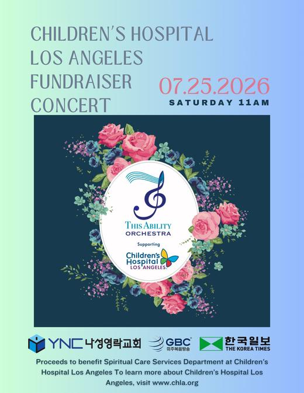



음악은 모두를 위한 자리를 만듭니다.



This Ability Network는 로스앤젤레스의 비영리단체입니다. This Ability Orchestra를 통해 모든 능력의 음악가들이 함께 연주하고 공연하며 지역사회에 나눔을 실천합니다.









## 네트워크 소개 {#network .section-title}

This Ability Network는 로스앤젤레스의 501(c)(3) 비영리단체입니다. 무대도, 연습실도, 지역사회도 모두가 자기 자리를 가질 때 더 좋아진다고 믿습니다.

저희의 활동은 2014년부터 음악을 만들어 온 This Ability Orchestra와, 여기서 비롯된 연주회와 행사를 중심으로 합니다.


## 프로그램 {#programs .section-title}



### This Ability Orchestra {#orchestra .section-title}



다양한 능력의 음악가들이 포용적이고 협력적인 공간에 함께 모입니다. 음악이라는 보편적인 언어를 통해 모든 참여자가 자신을 표현하고, 서로 연결되며, 저마다의 고유한 기여를 인정받습니다.

> 우리는 음악을 통해 세상과의 연결을 넓힙니다. 포용적인 환경에 대한 이해를 깊게 합니다.




#### 2014년부터 로스앤젤레스에서 음악을 만들어 왔습니다

단원들은 현악기, 관악기, 피아노 등을 나란히 연주합니다. 연습과 연주회는 각 음악가가 할 수 있는 것과 팀에 가져오는 것을 중심으로 꾸려집니다.




### 나눔으로 이어지는 연주회 {#concerts .section-title}

오케스트라는 매년 로스앤젤레스 어린이병원을 위한 후원 콘서트를 열고, 한 해 동안 다른 공연도 함께합니다.



- 

  2026년 7월 25일 오전 11시

  #### [2026 CHLA 후원 콘서트](/ko/events/2026-chla-fundraiser/)

  수익금은 로스앤젤레스 어린이병원의 영적 돌봄 서비스 부서를 지원하는 데 쓰였습니다. 후원자는 20달러에 CHLA 에코백을 받을 수 있었습니다.

- 

  2024년 10월 19일 오후 5시

  #### [2024년 10주년 기념 콘서트](/ko/events/2024-10th-anniversary/)

  10주년을 기념하는 무대에 소프라노 Hae Eun Jeon, 바리톤 Young Kwon, Vocielesti Children’s Choir가 함께했습니다.

- 

  2018년 5월 11일 오후 7시

  #### [2018 Celebrating Supermoms](/ko/events/2018-celebrating-supermoms/)

  YoungNak Church of LA에서 열린 어머니날 후원 콘서트입니다. 수익금은 로스앤젤레스 어린이병원의 Mark Taper–Johnny Mercer Artists Program을 지원하는 데 쓰였습니다.

- 

  2017년 5월 12일 오후 7시

  #### [2017 Celebrating Supermoms](/ko/events/2017-celebrating-supermoms/)

  Calvary Faith Church에서 열린 공연으로, 로스앤젤레스 어린이병원과 Mark Taper–Johnny Mercer Artists Program을 후원했습니다.



[전체 공연 및 행사 보기](/ko/events/)
{.tao-program-detail}





### 발달장애 음악가를 위한 2027 국제 행사 {#2027 .section-title}

2027년, 발달장애 음악가들이 함께 배우고 연주하는 국제 행사를 기획하고 알리고 있습니다.

- 개인 및 그룹 레슨을 포함한 마스터클래스
- 함께 열 지역사회 행사 (검토 중)

날짜, 장소, 등록 방법은 아직 준비 중입니다. 소식을 가장 먼저 받으시려면 이메일로 연락해 주세요.

[행사 소식 받기](mailto:info@thisabilitynetwork.com?subject=2027%20International%20Event)
{.tao-event-updates}

[2027 행사 자세히 보기](/ko/events/2027-international-event/)
{.tao-program-detail}



## 문의 및 후원 {#contact .section-title}

참여, 봉사, 협력, 후원을 원하시면 연락해 주세요. 여러분의 연락을 기다립니다.

- **이메일**: [info@thisabilitynetwork.com](mailto:info@thisabilitynetwork.com)
- **전화**: [323-979-3388](tel:+13239793388)
- **주소**: 1721 N Broadway Ave, Los Angeles
- **비영리단체**: This Ability Network, 501(c)(3), 고유번호(EIN) 93-1977627
