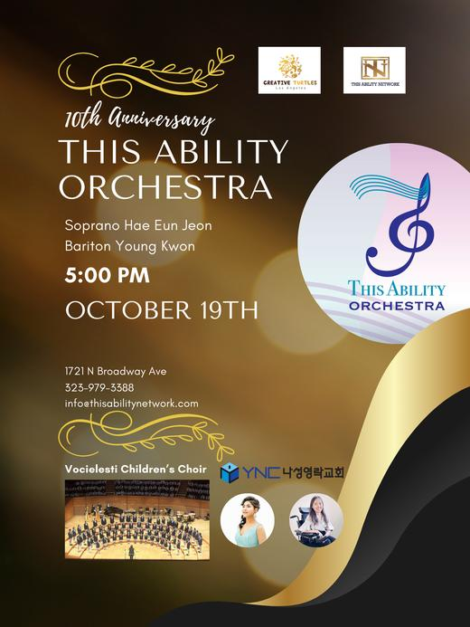

[Back to Events](/en/events/#2024)

**October 19, 2024, at 5 p.m.**

1721 N Broadway Ave

The concert featured soprano Hae Eun Jeon, baritone Young Kwon, and the Vocielesti Children’s Choir.

## Concert Poster

## Anniversary Photo {#photos}


  

